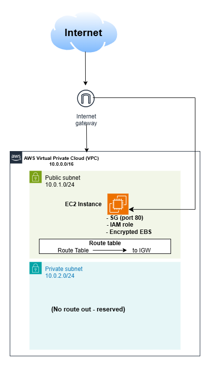

# aws-secure-baseline
A secure AWS environment - segmented networking, least-privilege access controls, and encrypted storage - provisioned entirely with terraform

## Architecture


## Project structure
```
.
├── vpc.tf, ec2.tf    # call the three modules and pass outputs between them
├── provider.tf       # AWS provider and default tags
├── versions.tf       # Terraform and provider versions
├── variable.tf       # input variables (project name, instance count, ...)
├── output.tf         # outputs
└── modules/
    ├── network/      # VPC, public and private subnets, internet gateway, route table
    ├── compute/      # EC2 web server, encrypted EFS file system and its security group
    └── security/     # web security group, IAM role, instance profile and policies
```

## What's built
- Modules - the code is split into three reusable modules: network, compute and security. The root files call each module and pass values between them, for example the compute module gets the subnet from the network module and the security group and instance profile from the security module.
- VPC - CIDR, DNS support and hostname enabled
- Subnets - public and private, CIDRs, unlike private subnet, public subnet has a public ip and can be accessed over the internet.
- Internet gateway + route table - IGW connects the VPC to the internet and route table directs non-local traffic (0.0.0.0/0) to the IGW - associated with the public subnet only, which is what makes it public.
- EC2 - AMI through data source, instance type and number of instances set through variables, userdata installs apache on EC2 during booting process for hosting a static website
- EFS - encrypted shared file system with a mount target, so the EC2 instance can store and share files
- Security group - port 80 allowed in, all ports allowed out
- IAM role - grants AmazonS3ReadOnlyAccess and SSM access, plus an inline policy for EFS, attached through instance profile
- Encryption - EBS root volume and EFS file system
- Variables/outputs - region, instance type, default tag(specifically project name and environment) were parameterized, public-ip outputed to terminal.

## Security decisions
- **Ports** : The security group inbound rule allows only port 80 and allows all ports for outbound rules. This implements the concept of access control which means only http traffic can reach my server
- **no-SSH** : Port 22 is closed and there is no key pair. The instance is accessed through SSM Session Manager instead, so remote login over SSH is not needed. While refactoring, I found a rule that opened SSH to 0.0.0.0/0 and removed it.
- **IAM role** Roles with permissions was configured and attached to ec2 instance because it is more secure than hardcoding IAM access keys.
- **encryption at rest** encryption for the EBS root volume and the EFS file system at rest removes the risk of copied and exposed data. its also important for compliance reasons.
- **account IAM split** separate user called for terraform which doesn't have console access in case of accidental access key leak. Also, it makes the audit log meaningful.
- **EFS access** : the EFS security group only allows NFS (port 2049) from the web server's security group, not from the internet. Using a security group as the source means only my instances can mount the file system.
- **No secrets in repo** .gitignore contains files should ignore when shipping to public repository because they could contain sensitive information.

## How to deploy
prerequisites: Terraform >= 1.7,  AWS credentials configured

      terraform init
      terraform plan
      terraform apply

Tear down: `terraform destroy`

## Limitations/Roadmap
- [x] Refactor into reusable modules (network, compute, security)
- [x] Remove public SSH access
- [ ] Multiple AZ subnets with load balancer
- [ ] IAM policy broader than needed
- [ ] No NAT gateway, as a result private subnet can't reach out yet
- [ ] CI checks (terraform fmt/validate) on pull request
- [ ] Update the architecture diagram to show EFS